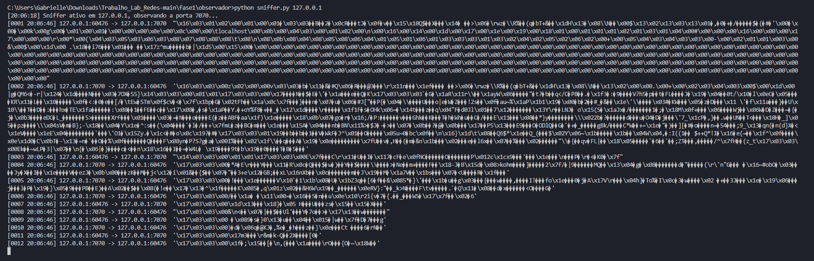
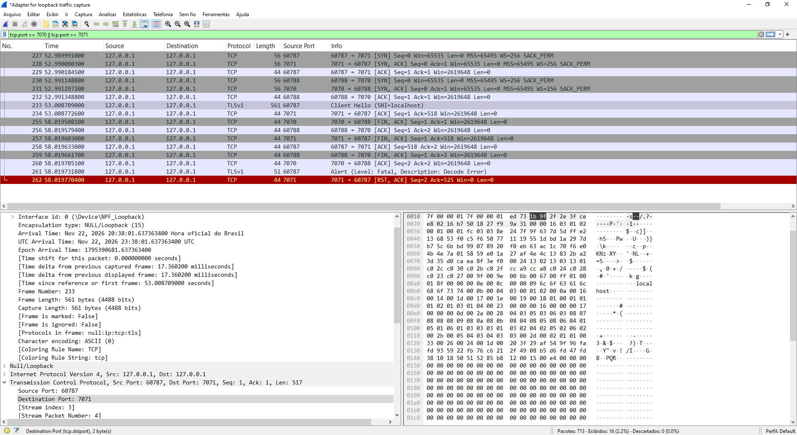
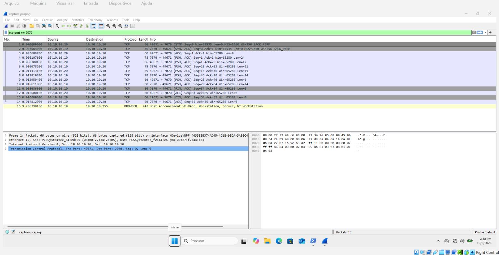
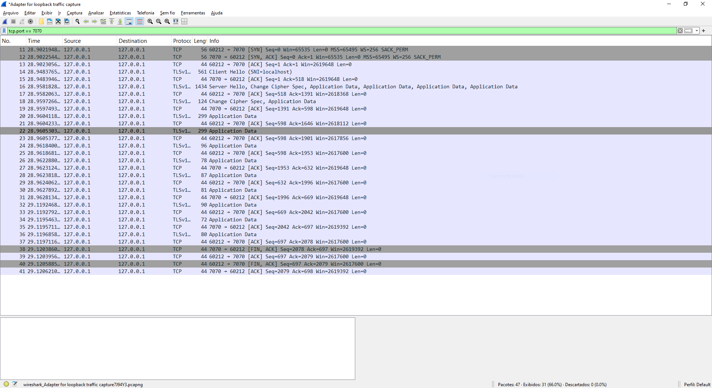
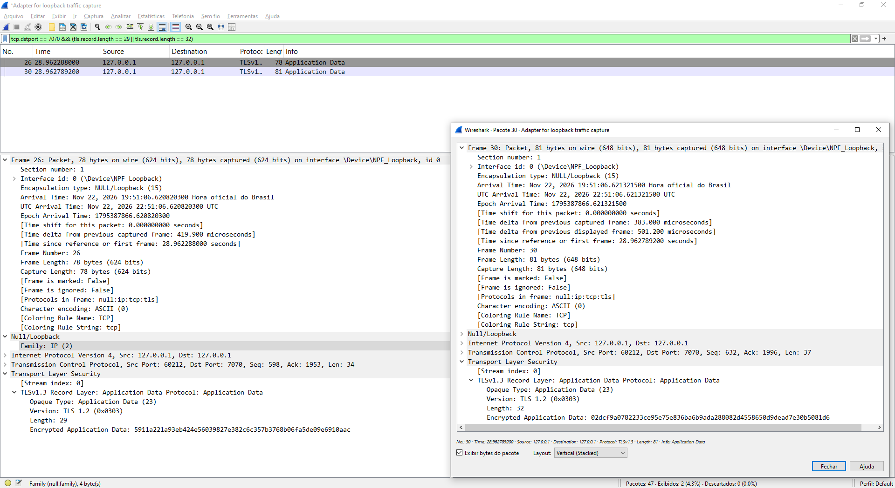

# Relatório Final Consolidado — Interceptação e Defesa de um Protocolo de Aplicação

**Disciplina:** Laboratório de Redes de Computadores — PUCRS
**Trabalho:** Interceptação e Defesa de um Protocolo de Aplicação (Fases 1, 2 e 3)

> **[PREENCHER — identificação do grupo]**
> - **Integrantes:** [nome 1], [nome 2], [nome 3]
> - **Data da entrega:** [__/__/2026]

---

## 1. Introdução

Este trabalho demonstrou, na prática, por que um protocolo de aplicação **sem
proteção** é vulnerável, e como uma defesa adequada o neutraliza. Construímos um
protocolo de login próprio — **SLAP** (*Simple Login Access Protocol*) — e, em
três fases, (1) quebramos sua **confidencialidade**, (2) quebramos sua
**integridade e autenticação**, e (3) implementamos a **defesa** que neutraliza
os dois ataques, discutindo a detecção.

## 2. Ambiente e topologia

Rede interna isolada no VirtualBox (`labredes`, sem saída para a internet), com
modo promíscuo habilitado. Três VMs:

| VM | IP | Papel |
|---|---|---|
| VM-servidor | `10.10.10.10:7070` | servidor SLAP |
| VM-cliente | `10.10.10.20` | cliente |
| VM-observador | `10.10.10.30` | atacante (sniffer na Fase 1, proxy na Fase 2) |

> A Fase 3 também pode ser demonstrada em um único computador via `localhost`
> (ver `fase3/README.md`), já que o cliente, o servidor e o canal TLS são
> multiplataforma.

O protocolo SLAP é texto ASCII, uma linha por mensagem (`\r\n`), inspirado no FTP
(`220`/`331`/`230`/`530`/`221`).

## 3. Fase 1 — Escuta passiva (quebra de confidencialidade)

Um **sniffer de socket raw** (`SIO_RCVALL`) na VM-observador, em modo promíscuo,
leu o tráfego entre cliente e servidor sem participar da conexão:

```
10.10.10.20:49673 -> 10.10.10.10:7070  *** CREDENCIAL CAPTURADA *** 'USER aluno'
10.10.10.20:49673 -> 10.10.10.10:7070  *** CREDENCIAL CAPTURADA *** 'PASS senha123'
```

Confirmado no Wireshark (pacotes 5 e 7 da captura, `tcp.port == 7070`). As
credenciais trafegam **em texto claro**: qualquer host na rede as lê.
→ Detalhes em `../fase1/RELATORIO.md`.

## 4. Fase 2 — Interceptação ativa / MITM (quebra de integridade e autenticação)

Um **proxy man-in-the-middle concorrente** posicionou-se entre cliente e servidor
(o cliente foi apontado ao proxy). Além de ler, ele **alterou** o tráfego: o
cliente fez login como `aluno`/`senha123`, mas o proxy reescreveu a credencial em
trânsito para `professor`/`acesso2026`:

```
[C->S] *** MODIFICADO *** b'USER aluno\r\n'   -> b'USER professor\r\n'
[C->S] *** MODIFICADO *** b'PASS senha123\r\n' -> b'PASS acesso2026\r\n'
```

- **Cliente:** enviou `USER aluno`, recebeu `230` → acredita ser **aluno**.
- **Servidor:** registrou `Login OK: usuario='professor'` → autenticou **professor**.

Nenhuma das pontas detectou a troca de identidade — quebra combinada de
integridade e autenticação. O proxy ainda atende **múltiplas sessões
simultâneas** (modelo de threads e regiões críticas em `../fase2/CONCORRENCIA.md`).
→ Detalhes em `../fase2/RELATORIO.md`.

## 5. Fase 3 — Defesa e detecção

A defesa encapsula o canal em **TLS** e protege as credenciais:

### 5.1 Confidencialidade e integridade (TLS)
O socket TCP passa a ser envelopado por TLS (módulo `ssl`). O handshake negocia
cifra e chaves de sessão; todo o conteúdo SLAP vira `Application Data` cifrado.
Na prática, foi negociado **TLS 1.3 / TLS_AES_256_GCM_SHA384**:

```
[TLS estabelecido: TLSv1.3 / TLS_AES_256_GCM_SHA384 - certificado do servidor validado]
< 220 slap-server pronto (TLS)
> USER aluno
< 230 login bem-sucedido
```

### 5.2 Autenticação do servidor (certificado)
O servidor apresenta um **certificado X.509**; o cliente o valida contra uma CA de
confiança (`servidor.crt`) e confere o nome (`check_hostname`). Um servidor que
apresente outro certificado é rejeitado.

### 5.3 Senhas com hash
O servidor **não guarda mais a senha em texto claro**: armazena
**PBKDF2-HMAC-SHA256** (salt + hash, 200 000 iterações) e compara com
`hmac.compare_digest`. Mesmo que o arquivo do servidor vaze, as senhas não são
recuperáveis diretamente.

### 5.4 Demonstrações da defesa

| # | Cenário | Resultado observado |
|---|---|---|
| 1 | Cliente + servidor legítimos | TLS 1.3 estabelecido, `230 login bem-sucedido` |
| 2 | Sniffer da Fase 1 observando | só **ciphertext** — nenhum `USER`/`PASS` legível |
| 3 | Proxy MITM da Fase 2 no caminho | lê só lixo cifrado (ex.: byte de alerta `\x15`) e **quebra** o handshake TLS |
| 4 | MITM com certificado próprio | cliente **aborta antes de enviar a senha** |

Saída real do cenário 4 (detecção):
```
!!! ATAQUE DETECTADO / CONEXAO ABORTADA !!!
    O certificado do servidor NAO e confiavel: self-signed certificate
    Possivel man-in-the-middle se passando pelo servidor.
    Nenhuma credencial foi enviada.
```

**Evidência do cenário 2 — sniffer da Fase 1 contra o TLS.** Captura apenas bytes
cifrados (`\x16\x03…`), sem nenhum `USER`/`PASS` legível:



**Evidência do cenário 3 — proxy MITM da Fase 2 contra o TLS.** Ao interferir no
handshake, provoca um alerta fatal do TLS (`Alert: Decode Error`) e a conexão é
derrubada (`RST`):



## 6. Prova antes/depois com Wireshark

Captura na porta 7070 (`tcp.port == 7070`), comparando o tráfego antes e depois
da defesa.

**ANTES (Fases 1–2) — texto claro.** O payload mostra `USER aluno` e
`PASS senha123` legíveis (pacotes 5 e 7):



**DEPOIS (Fase 3) — TLS.** O handshake aparece como `TLSv1.3` e todo o conteúdo
vira `Application Data` cifrado: o que antes era legível tornou-se ilegível:



Os mesmos dados que na Fase 1 trafegavam como `USER`/`PASS` em claro aparecem agora
como `Encrypted Application Data` (pacotes 26 e 30, isolados pelo tamanho do
registro TLS):



## 7. Análise de ameaças e detecção

| Ameaça | Mitigada? | Como a defesa age | Como o defensor detecta o ataque |
|---|---|---|---|
| **Sniffing** (escuta passiva) | Sim | TLS cifra o payload; o sniffer vê só ciphertext | O ataque é silencioso, mas **fica inócuo**; no Wireshark o conteúdo aparece como `Application Data` ilegível |
| **MITM — leitura/alteração** (proxy relay) | Sim | Sem a chave de sessão, o proxy não decifra nem forja; alterar o ciphertext corrompe o registro | A **verificação de integridade do TLS** (MAC/AEAD) falha → alerta TLS e queda da conexão |
| **MITM — personificação do servidor** | Sim | O cliente valida o certificado do servidor | **Erro de validação de certificado** no cliente (`CERTIFICATE_VERIFY_FAILED`) — detecção explícita e imediata |
| **Adulteração** de mensagens | Sim | AEAD (AES-GCM) garante integridade por registro | Falha de decifragem/autenticação → alerta `bad_record_mac` |
| **Replay** (reenvio de pacotes) | Parcial | TLS numera os registros dentro da sessão (nonce/sequência), impedindo replay **intra-sessão** | Registros fora de ordem/duplicados são descartados pelo TLS. *Replay de uma sessão inteira* exigiria defesa de aplicação (nonce/token por login) |
| **Roubo do arquivo de senhas** | Mitigada | Senhas em PBKDF2 (salt + hash) | Não detectável pela rede; reduz o dano (senhas não ficam em claro) |

**Sinais observáveis de uma tentativa de ataque:** erros de validação de
certificado no cliente, alertas de handshake TLS (`bad_certificate`,
`bad_record_mac`), quedas repetidas de conexão logo após o `ClientHello`, e, no
servidor, handshakes que falham (clientes sem TLS, como o cliente/sniffer antigos,
não completam o handshake).

## 8. Limitações da defesa

- **Metadados continuam visíveis:** IPs, portas, tamanho e horário dos pacotes. Um
  observador sabe *que* houve uma conexão ao servidor na porta 7070, e quando —
  só não vê o conteúdo.
- **Certificado auto-assinado:** a confiança depende de distribuir o
  `servidor.crt` ao cliente por um canal seguro. Em produção, usar-se-ia uma CA
  reconhecida. Se o cliente aceitasse qualquer certificado (sem validar), o MITM
  voltaria a funcionar — a validação é o ponto crítico.
- **Sem autenticação do cliente:** autenticamos o servidor; o cliente é
  autenticado só pela senha (agora protegida). Poderíamos exigir **certificado de
  cliente** (mTLS) para autenticação mútua.
- **Fora do escopo:** ataques de negação de serviço, exploração de
  vulnerabilidades da implementação TLS, e ataques ao endpoint (malware na
  máquina) não são cobertos por esta defesa de canal.

## 9. Conclusão

As três fases, em conjunto, mostram o ciclo completo: um protocolo em texto claro
expõe credenciais (Fase 1) e permite adulteração sem detecção (Fase 2); ao
adotar **TLS com autenticação por certificado e senhas com hash** (Fase 3), o
sniffer passa a ver apenas ciphertext, o proxy MITM perde a capacidade de ler e
alterar, e a tentativa de personificação é **detectada e bloqueada** antes de
qualquer dado sensível ser enviado. A defesa é eficaz contra sniffing, MITM e
adulteração, com limitações conhecidas (metadados, confiança no certificado,
ausência de autenticação de cliente) que indicam os próximos passos de
endurecimento.

## Anexos

- Código: `fase1/` (serviço + sniffer), `fase2/` (proxy MITM), `fase3/` (serviço
  protegido + certificados).
- Relatórios por fase: `fase1/RELATORIO.md`, `fase2/RELATORIO.md`.
- Evidências: `fase1/evidencias/`, `fase2/evidencias/`, `fase3/evidencias/`.
- Guia de apresentação com trechos de código: `apresentacao.html` (raiz).
